# How Kiro built HeadwayHold

Kiro wrote the steering, the spec, the project setup and the whole simulation model with its tests. It ran headless in the **Kiro CLI 2.34.0** (`kiro-cli chat --no-interactive`, V3 agent engine, model `claude-sonnet-4.5`), one wave at a time, under a custom agent (`.kiro/agents/headway-builder.json`) with a shell guard hook (`.kiro/hooks/`). Claude Code (Anthropic) drove those runs: it wrote the agent and hooks, gave Kiro each wave's prompt, checked the result, sent failures back, and committed each passing wave.

**Kiro's monthly credits ran out during wave 3** ("You've reached your monthly usage limit"). With the deadline hours away, Claude Code wrote the rest of the page itself. Every file below says who wrote it.

## The Kiro runs
| Run | What Kiro did | Minutes | Result |
|---|---|---|---|
| 0a Steering | Turned Claude Code's notes into `.kiro/steering/product.md`, `tech.md`, `structure.md` | 0.5 | Kept every rule, string and number |
| 0b Spec | Wrote `.kiro/specs/headway-hold/`: 12 requirements in EARS form (107 SHALL lines), 5 correctness properties, 39 tasks in 4 waves | 5.8 | Accepted |
| 1 Setup | `package.json`, page skeleton, styles, `params.json` (20 assumptions, each with a note), Pages workflow, fonts | 2.9 | Accepted |
| 2 Model | `site/lib/` (seeded noise, holding rule, simulator, metrics, sweep) and 39 tests, 5 of them fast-check properties | 20.1 | Tests passed, but a full Red Line run was wrong (12 defects) |
| Fix 1 | Asked to fix the 12 defects | 16.5 | Not fixed; 5 tests had been loosened |
| Fix 2 | Spec first: wrote the exact event loop into `design.md` ("Simulation Algorithm"), then rewrote `sim.js` to follow it and restored the 5 tests | 16.7 | Fixed: matches Claude Code's independent implementation exactly, on every seed |
| 3 Page | Started `scripts/capture.mjs` | 7.2 | Stopped: credits ran out |

Kiro working time: about 70 minutes over 7 runs.

## The lesson Kiro's spec taught
The first design said what the simulator should do but not the order of events inside one simulated second. Each rewrite guessed, and the guesses looked fine in unit tests. Writing the event loop into the spec (fix 2) is what made the model right, and it now reproduces the reference numbers exactly. Spec first, then code.

## Who wrote what
| Files | Written by |
|---|---|
| `.kiro/steering/`, `.kiro/specs/headway-hold/` | Kiro |
| `package.json`, `site/index.html`, `site/styles.css`, `site/data/params.json`, `.github/workflows/pages.yml` | Kiro (Claude Code later fixed the GitHub link, added a favicon line and appended chart and panel styles) |
| `site/lib/` (rng, controller, sim, metrics, sweep) | Kiro |
| `test/*.test.mjs`, `test/validate-late.mjs` | Kiro |
| `scripts/capture.mjs` | Kiro started it; Claude Code fixed it (vehicles name child platforms such as `70074`, so stops now map to their parent station; Charles/MGH replaces Shawmut, which is on the Ashmont branch; Harvard's stop ID; direction-aware ring index) and finished it |
| `scripts/sweep.mjs`, `site/app.js`, `site/render.js` | Claude Code, after Kiro's credits ran out |
| `.kiro/agents/`, `.kiro/hooks/` | Claude Code |
| `README.md`, `KIRO.md`, `site/eli5/`, `diagrams/`, `media/` | Claude Code |

## Hooks
The shell guard (`.kiro/hooks/shell_guard.py`) checked every shell command Kiro ran: 51 allowed and 10 blocked (`.kiro/hooks/guard.log`). Nine blocks were false positives on `npm test 2>&1 | ...`, fixed in the guard during the day; one was a real block of a write outside the repo.

## How the result was checked
- `npm test`: 39 tests pass, including the 5 fast-check properties (determinism, train order, bounds, gain 0 equals no control, hold cap).
- Claude Code's independent implementation of the spec's algorithm gives exactly the same numbers as Kiro's `sim.js` (One late train: 7.98 min uncontrolled, best gain 0.75, 9.3% shorter wait, 20 of 20 seeds better).
- A frozen Playwright test of the page (desktop and iPhone, with and without the snapshot) passes.
