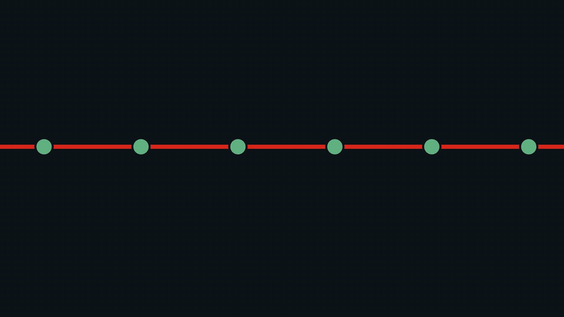

# HeadwayHold

**Red Line trains bunch. One rule spreads them out.** Each train waits until it is halfway between the train ahead and the train behind. In this simulation, that cuts the average wait by 9.3%, counting every second riders spend held on board.

**Try it now: https://wilsonwu-ai.github.io/headway-hold/** (works on a phone, no install, no account)


Built in one day at **Hackachusetts** (October 24, 2026), Civic action track. Kiro wrote the steering, the spec, the simulation model and its tests, running headless in the Kiro CLI. Kiro's monthly credits ran out during the page wave, so Claude Code (Anthropic) wrote the page itself (`site/app.js`, `site/render.js`), finished the data capture and wrote the sweep script. Claude Code also ran each Kiro wave and checked it. How Kiro was used, feature by feature: **[KIRO.md](KIRO.md)**.

> A simplified simulation of one line with an idealized holding rule, seeded by one captured MBTA vehicle snapshot. Not affiliated with the MBTA, and not an operational recommendation.

## Watch
[](media/headway-hold-motion.mp4)

Demo video (under 2 minutes): the 12-second motion graphic above; a full walkthrough is linked from the SundAI card

## Start here: the picture explainer
Nine pictures, a few words each: **[the picture version](https://wilsonwu-ai.github.io/headway-hold/eli5/)**.

## ELI5: the whole hack in one paragraph
Trains on the Red Line go around and around. When one train runs a little late, more people pile up at its next stop, so loading takes longer and it falls further behind. The train behind it finds almost nobody waiting, so it catches up. Soon two trains arrive together, and then nobody comes for a long time. HeadwayHold tries one simple rule: at a few big stations, each train waits until it sits halfway between the train in front and the train behind. Wait too little and trains still bunch. Wait too much and riders sit on a stopped train for nothing. The slider lets you find the sweet spot yourself.

## The big picture
**Why bunching feeds itself**



**What happens at a control station**



## Map of this repo
| Path | What it is | Written by |
|---|---|---|
| `site/lib/` | The simulator, holding rule, metrics and sweep | Kiro |
| `site/index.html`, `site/styles.css` | Page skeleton and styles | Kiro (Claude Code added the chart and panel styles) |
| `site/app.js`, `site/render.js` | Page logic, panels and chart | Claude Code (Kiro's credits ran out) |
| `site/data/` | Parameters (Kiro); stations, snapshot and sweep (generated by the scripts) | Kiro / scripts |
| `site/eli5/` | The picture explainer | Claude Code |
| `scripts/` | `capture.mjs` (MBTA snapshot; Kiro started it, Claude Code fixed and finished it) and `sweep.mjs` (the headline numbers) | Kiro, Claude Code |
| `test/` | `node:test` acceptance tests and fast-check property tests | Kiro |
| `.kiro/steering/` | Product, tech and structure rules Kiro follows on every request | Kiro |
| `.kiro/specs/headway-hold/` | The spec: requirements, design, tasks | Kiro |
| `.kiro/agents/`, `.kiro/hooks/` | The custom agent Kiro ran under, its permissions and hooks | Claude Code |
| `kiro-prompts/` | The prompt for each Kiro run | Claude Code |
| `.github/workflows/` | GitHub Pages deploy | Kiro |
| `diagrams/`, `media/` | Diagrams, the motion graphic and the QR code | Claude Code |
| `README.md`, `KIRO.md` | This file and the Kiro write-up | Claude Code |

## S: Situation
### Hackachusetts
Hackachusetts is the Mass AI Coalition's statewide student hackathon, run with SundAI and powered by Kiro, on October 24, 2026: four tracks, nine campuses, one day. Entries must be built with Kiro. This entry is in the Civic action track, challenge V3 ("Safer and connected places"), which offers MBTA data.

### The problem: bunching
- **A bus or train line is unstable on its own.** A late train meets more waiting riders, so boarding takes longer and it falls further behind. The train behind meets fewer riders and catches up.
- **Riders feel the gaps, not the number of trains.** With the same trains, uneven gaps make the average wait longer, because more riders arrive during the long gaps.
- **Holding is the textbook fix:** letting a train wait a little at a stop. Zhou, Koutsopoulos and Saidi (2020) simulated the Red Line itself. They found that dwell-time control helps, but is less effective and robust than skip-stop or consolidation.

HeadwayHold does not claim a new method. It makes the trade-off playable.

## T and A: Task and Action
### Task
In one day and solo, build a phone-first page that a stranger can use alone. It shows what one holding rule does to Red Line waits, with every number sourced and the limits stated.

### Action: how it was built


1. **Spec first.** A brief with 16 acceptance criteria and a 28-step browser test, both frozen before any code existed.
2. **Kiro wrote the steering, then the spec.** The spec has 12 requirements in EARS form, 5 correctness properties and 39 tasks in four waves.
3. **Kiro wrote the code, one wave at a time.** It ran headless in the Kiro CLI, under a custom agent with its own permissions and hooks. It wrote the setup and the whole simulation model with 39 tests; its credits ran out partway through the page wave.
4. **Claude Code checked every wave, then finished the page.** It ran `npm test` and the frozen browser test, sent failures back to Kiro with the rule each one broke, and committed each passing wave. Details and numbers: [KIRO.md](KIRO.md).

### The model
- **The line:** the Red Line from Alewife to Braintree as a loop of 34 platforms, with 10 trains.
- **Riders** arrive at every platform, three times as many downtown.
- **Dwell grows with the riders waiting.** This is what makes bunching feed itself.
- **Trains never overtake.**
- **Seeded randomness:** the "No control" and "HeadwayHold" panels see exactly the same delays, and the same seed always gives the same numbers.
- **Every assumption** lives in `site/data/params.json` with a note, and the page shows them in a table.

### The rule
The rule acts at five control stations: Alewife, Harvard, Park Street, JFK/UMass and Braintree.
1. A train finishes boarding.
2. It compares the gap to the train behind with the gap to the train ahead.
3. If the gap behind is longer, it holds for gain × half the difference, up to 3 minutes.

Gain 1 means exactly halfway.

### Data
- **Real start:** this scenario places trains where the MBTA V3 API had them at 19:37 ET on October 24, 2026 (`site/data/snapshot.json`). Only Braintree trips are kept.
- **Stations:** names and coordinates come from the MBTA V3 stops endpoint.
- **Nothing is fetched at runtime.** The page loads only its own files.



## R: Result
- **Live:** https://wilsonwu-ai.github.io/headway-hold/ (golden path: the frozen browser test passes on desktop and iPhone viewports, with and without the snapshot)
- **Headline:** 9.3% shorter average wait at the best gain (0.75), counting time held on board. This is the mean over seeds 1 to 20 in the "One late train" scenario (`site/data/sweep.json`). Platform waits alone are 15.8% shorter.
- **Rush hour:** 5.1%. **Real start:** 11.5%. A real start can stay bunched, because a 3-minute cap per stop cannot undo a badly bunched start.
- **Tests:** 39 passing, including fast-check property tests (`npm test`).
- **Limits:** no signals, safety spacing or crew limits; one line; an idealized rule; one snapshot. Wait times are outputs of this simulation, not measured service.

## Run it yourself
```bash
npm install                            # dev only: fast-check for the property tests
npm test
npm run sweep                          # recompute site/data/sweep.json
python3 -m http.server 8000 -d site    # any static server works; then open http://localhost:8000
```

## Glossary
- **Headway:** the time between consecutive trains at a stop.
- **Bunching:** trains running nose to tail, with a long gap behind them.
- **Holding:** a train waiting extra seconds at a control station.
- **Dwell:** the time a train stands at a platform.
- **Gain:** how much of the imbalance between its two neighbors a train corrects. 1 means exactly halfway.

## Sources
- MBTA V3 API: https://www.mbta.com/developers/v3-api
- Zhou, Koutsopoulos and Saidi (2020), "Evaluation of Subway Bottleneck Mitigation Strategies using Microscopic, Agent-Based Simulation": https://www.worldtransitresearch.info/research/7979
- Kiro documentation: https://kiro.dev/docs/
- Overpass font (SIL Open Font License): https://github.com/google/fonts/tree/main/ofl/overpass
